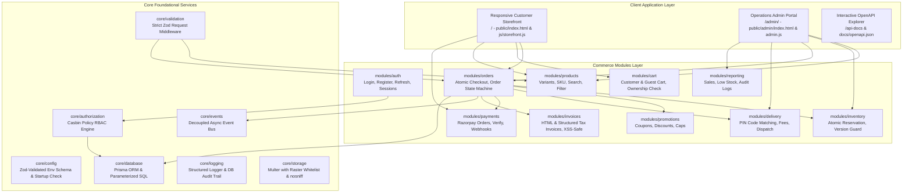

# Secure, Reusable, Component-Based E-Commerce Platform
**Organisation:** ALGIONS AI LABS PRIVATE LIMITED  
**License:** Apache-2.0  
**Node.js Version:** v20+ / v22+ LTS  
**Branch:** `fix/razorpay-preproduction`  

A complete, production-grade e-commerce application and backend for local retail businesses (groceries, sweet shops, apparel boutiques, electronics). Built according to the core principle: **"Reuse working, well-maintained open-source code instead of writing every feature from scratch."**

---

## 🚀 Key Capabilities

- **Core Foundation**: Type-safe relational schema with [Prisma](https://github.com/prisma/prisma) (SQLite/PostgreSQL), strict [Zod](https://github.com/colinhacks/zod) runtime boundary validation, structured JSON logging, and database audit logs.
- **Access Control & Security**: Server-side [Casbin](https://github.com/apache/casbin-node-casbin) RBAC enforcer with deny-by-default access, bcrypt (12 salt rounds), rotating session tokens, sliding-window rate limiters, IDOR protection, and secure invoice authorization with guest access tokens.
- **Product Catalogue**: Multi-variant products (size, color, weight), master SKU, slug generator, secure image upload with raster MIME validation (SVG active content eliminated), and multi-filter search.
- **Inventory & Oversell Prevention**: Atomic database transactions (`$transaction`) with optimistic concurrency locking (`version` guards) and backoff retries, preventing overselling under high concurrency. Real-time low-stock alerts.
- **Shopping Cart & Checkout**: Customer & guest session carts with strict item ownership verification, real-time stock checks, dynamic taxes, and discount coupons with maximum caps and threshold rules.
- **Local Delivery & PIN Zones**: PIN code serviceability validation, delivery fee rules, free delivery thresholds, and order assignment to delivery personnel.
- **Orders & Payments with Razorpay**: 
  - Official Razorpay Node.js SDK integration.
  - Server-side order creation using trusted database order amounts (calculated in paise: 100 paise = 1 INR).
  - Timing-safe HMAC-SHA256 checkout signature verification.
  - Authoritative server-side payment capture verification (`razorpay.payments.fetch`).
  - Signed webhook verification using exact raw body and `X-Razorpay-Signature`.
  - Strictly idempotent webhook processing (`payment.captured`, `order.paid`, `payment.failed`).
  - Public mock payments removed from production routes and restricted to isolated test suites.
- **Order State Machine**: Explicit status transition policies (`PENDING` -> `PAID`/`PROCESSING` -> `DISPATCHED` -> `DELIVERED`), preventing duplicate stock deduction or illegal state transitions.
- **Invoices & Receipts**: Automated tax invoice generation with breakdown of items, discounts, GST/tax, delivery fees, printable HTML receipts with full XSS escaping, and guest access tokens.
- **Reporting & Operational Dashboards**: Sales revenue, order status distribution, best-selling products, low-stock warnings, and security audit log queries.
- **Interactive UI & Documentation**:
  - 🛒 **Customer Storefront**: Responsive shopping catalog, product quick-view, cart drawer, checkout modal, Razorpay Checkout launcher, and safe order tracking.
  - 🏢 **Operations Admin Portal**: Shop management dashboard for products, inventory restock, order fulfillment, delivery zones, and audit logs.
  - 📖 **Interactive OpenAPI 3.0 UI**: Swagger UI explorer hosted at `/api-docs`.

---

## 🏗️ Architecture



---

## 🧪 Automated Test Suite (55 Tests, 100% Passing)

Testing covers all critical components:
- **Unit Tests**: Pricing, discount calculations, tax rules, and coupon limits (`tests/unit/`).
- **Security & RBAC Tests**: Deny-by-default (401), privilege escalation defense (403), Casbin policy wildcard check, input validation (400), IDOR defense, private order protection, anonymous invoice protection, cross-customer cart ownership, payment authorization, and order state machine (`tests/security/`).
- **High-Concurrency Tests**: 10 simultaneous requests for 2 stock units yield exactly 2 successes and 8 failures with atomic version checks; concurrent checkouts for limited inventory (`tests/concurrency/`).
- **Razorpay Integration & Webhook Tests**: Server-side order creation in paise, checkout signature verification, payment ID matching, amount validation, uncaptured status rejection, API failure handling, HMAC-SHA256 webhook verification, and idempotent delivery (`tests/integration/`).
- **Local Delivery Tests**: PIN code matching, delivery fee rules, and free delivery thresholds (`tests/integration/`).
- **End-to-End Checkout**: Full customer journey from registration to product selection, cart, coupon application, checkout, invoice generation, and tracking (`tests/checkout.e2e.test.ts`).
- **Post-Deployment Smoke Tests**: Health checks, database connectivity, and security headers (`tests/smoke.test.ts`).

```bash
# Run all automated tests:
npm test

# Run specific suites:
npm run test:unit
npm run test:security
npm run test:concurrency
npm run test:integration
npm run test:e2e
```

---

## ⚡ Quick Start

### 1. Install Dependencies
```bash
npm ci
```

### 2. Configure Environment
```bash
cp .env.example .env
```
Set your Razorpay Test Mode credentials:
```env
RAZORPAY_KEY_ID=rzp_test_...
RAZORPAY_KEY_SECRET=...
RAZORPAY_WEBHOOK_SECRET=...
```

### 3. Initialize Database & Seed Store Data
```bash
npm run prisma:generate
npm run prisma:push
npm run prisma:seed
```

### 4. Build and Start Server
```bash
npm run build
npm start
```

- **Storefront**: [http://localhost:3000/](http://localhost:3000/)
- **Admin Dashboard**: [http://localhost:3000/admin/](http://localhost:3000/admin/)
- **OpenAPI Interactive Documentation**: [http://localhost:3000/api-docs](http://localhost:3000/api-docs)
- **Health Check API**: [http://localhost:3000/api/health](http://localhost:3000/api/health)

### Default Test Accounts
- **Admin**: `admin@algions.local` / `Admin@123456`
- **Manager**: `manager@algions.local` / `Staff@123456`
- **Staff**: `staff@algions.local` / `Staff@123456`
- **Delivery**: `rider@algions.local` / `Rider@123456`
- **Customer**: `customer@example.com` / `Customer@123456`

---

## 📚 Documentation
- [Architecture Decision Record & Specification](docs/components-catalog.md)
- [Independent Client Deployment Guide](docs/deployment.md)
- [Open-Source Dependency & License Inventory](docs/licenses-inventory.md)
- [Security Review & Residual Risk Assessment](docs/security-review.md)
- [OpenAPI 3.0 Contract Specification](docs/openapi.json)
